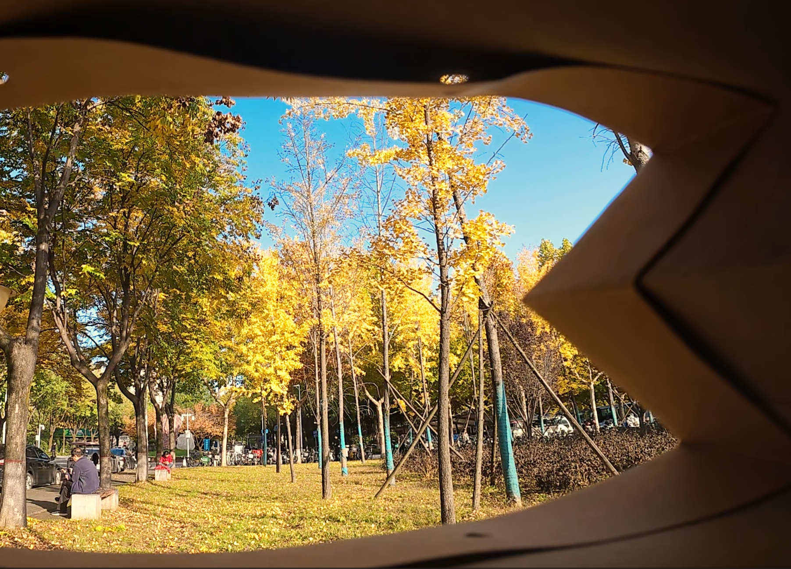
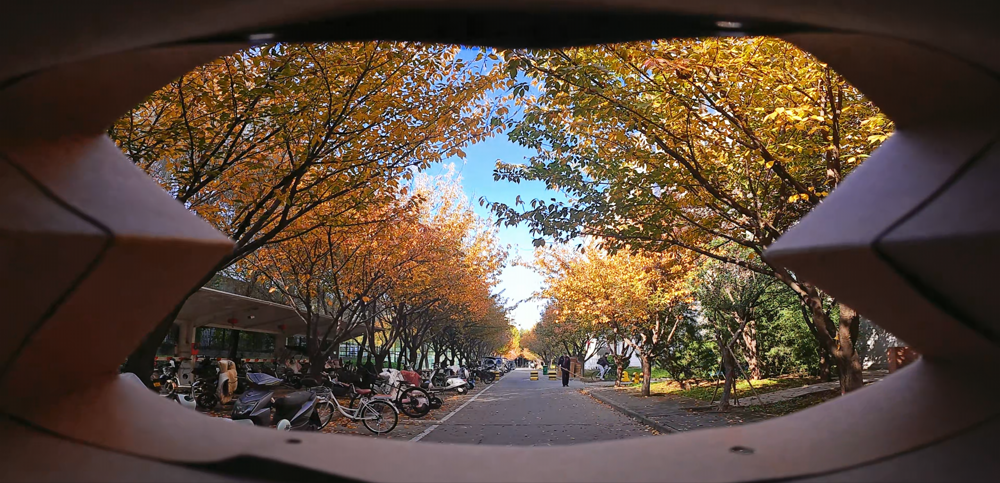

  <section class="home-col home-posts">
    <h2>文章推送</h2>
    <ul class="post-list">

      <li>
        {{ post.date | date: "%Y-%m-%d" }}
        <a href="{{ post.url | relative_url }}">{{ post.title }}</a>
      </li>

    </ul>

    
还没有文章。往 `_posts/` 里放一个 md 文件就有了。


  </section>

  <section class="home-col home-gallery">
    <h2>图片</h2>
    

      <figure></figure>
      <figure></figure>
    

  </section>

